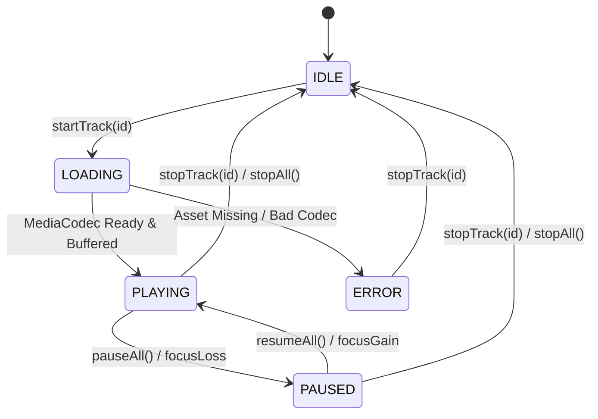

# Data Model: Core Multi-Stream Audio Looping Engine

**Feature**: `001-audio-loop-engine`  
**Date**: 2026-10-17  
**Status**: Completed  

---

## 1. Domain Entities

### 1.1 `SoundTrack`
Represents an individual sound asset cataloged in the application manifest.

| Field | Type | Description | Validation / Constraints |
| :--- | :--- | :--- | :--- |
| `id` | `String` | Unique alphanumeric identifier for the sound | Non-empty, alphanumeric with hyphens/underscores (e.g. `"rain"`) |
| `name` | `String` | Human-readable localized title | Non-empty, max 50 characters (e.g. `"Gentle Rain"`) |
| `category` | `SoundCategory` | Grouping category | Enum value (see `SoundCategory`) |
| `assetPath` | `String` | Path relative to application assets directory | Non-empty, points to valid `.ogg`, `.opus`, `.mp3`, or `.wav` file |
| `defaultVolume` | `Float` | Initial volume recommendation | Clamped between `0.0f` and `1.0f` (inclusive) |

```kotlin
data class SoundTrack(
    val id: String,
    val name: String,
    val category: SoundCategory,
    val assetPath: String,
    val defaultVolume: Float = 0.7f
)
```

---

### 1.2 `SoundCategory`
Enumeration of ambient sound categories.

```kotlin
enum class SoundCategory {
    NATURE,
    WEATHER,
    AMBIENCE,
    NOISE,
    SLEEP
}
```

---

### 1.3 `TrackPlaybackStatus`
Runtime status of an individual audio stream.

```kotlin
enum class TrackPlaybackStatus {
    IDLE,       // Not active / player unallocated
    LOADING,    // Buffering or acquiring audio decoder
    PLAYING,    // Actively looping and producing audio
    PAUSED,     // Temporarily paused; decoder retained
    ERROR       // Failed to load, decode, or allocate player
}
```

---

### 1.4 `TrackPlaybackState`
Runtime state snapshot of an individual track managed by the engine.

| Field | Type | Description | Invariants |
| :--- | :--- | :--- | :--- |
| `soundId` | `String` | Identifier matching `SoundTrack.id` | Must reference valid track ID |
| `status` | `TrackPlaybackStatus` | Current operational status | Never null |
| `volume` | `Float` | Track-specific volume level | Clamped between `0.0f` and `1.0f` |
| `isMuted` | `Boolean` | Track-specific mute toggle | Boolean flag |
| `errorMessage` | `String?` | Error description if status == `ERROR` | Null unless status is `ERROR` |

```kotlin
data class TrackPlaybackState(
    val soundId: String,
    val status: TrackPlaybackStatus = TrackPlaybackStatus.IDLE,
    val volume: Float = 1.0f,
    val isMuted: Boolean = false,
    val errorMessage: String? = null
) {
    val isAudible: Boolean
        get() = status == TrackPlaybackStatus.PLAYING && !isMuted && volume > 0f
}
```

---

### 1.5 `AudioFocusState`
State of system platform audio focus.

```kotlin
enum class AudioFocusState {
    NONE,           // No focus requested / idle
    ACQUIRED,       // Full audio focus granted
    DUCKED,         // Transient focus loss; volume ducked by >=60%
    LOST            // Permanent focus loss; playback paused
}
```

---

### 1.6 `AudioMixState`
Aggregate runtime state of the entire multi-stream engine.

| Field | Type | Description | Invariants |
| :--- | :--- | :--- | :--- |
| `masterVolume` | `Float` | Global volume multiplier | Clamped between `0.0f` and `1.0f` |
| `isMasterPaused` | `Boolean` | Global playback pause flag | If true, all players are paused |
| `activeTracks` | `Map<String, TrackPlaybackState>` | Map of soundId to runtime track state | Maximum 8 active entries |
| `audioFocusState` | `AudioFocusState` | Current platform focus state | Tracks platform lifecycle |

```kotlin
data class AudioMixState(
    val masterVolume: Float = 1.0f,
    val isMasterPaused: Boolean = false,
    val activeTracks: Map<String, TrackPlaybackState> = emptyMap(),
    val audioFocusState: AudioFocusState = AudioFocusState.NONE
) {
    val playingTrackCount: Int
        get() = activeTracks.values.count { it.status == TrackPlaybackStatus.PLAYING }

    val hasActiveTracks: Boolean
        get() = activeTracks.isNotEmpty()
}
```

---

## 2. State Machine & Lifecycle Transitions

### 2.1 Individual Track State Machine



### 2.2 Volume Attenuation Formula
For any track $i$, the effective hardware gain $G_i$ sent to `ExoPlayer.setVolume()` is:

$$G_i = \begin{cases} 
0.0 & \text{if } \text{isMasterPaused} \lor \text{track.isMuted} \lor \text{track.status} \neq \text{PLAYING} \\
V_i \times V_{\text{master}} \times D & \text{otherwise}
\end{cases}$$

Where:
- $V_i \in [0.0, 1.0]$ is track volume (`track.volume`).
- $V_{\text{master}} \in [0.0, 1.0]$ is master volume (`mixState.masterVolume`).
- $D = \begin{cases} 0.3 & \text{if } \text{audioFocusState} == \text{DUCKED} \\ 1.0 & \text{otherwise} \end{cases}$

Transitions in $G_i$ are smoothed over 30ms via `VolumeRampHandler`.
