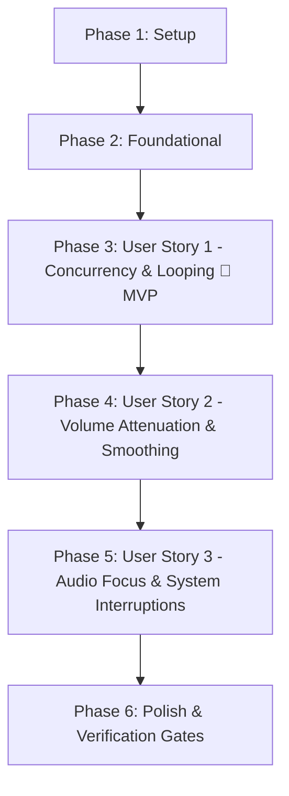

# Implementation Tasks: Core Multi-Stream Audio Looping Engine

**Feature**: `001-audio-loop-engine`  
**Date**: 2026-10-17  
**Spec**: [spec.md](spec.md) | **Plan**: [plan.md](plan.md)  
**Status**: Ready for Implementation  

---

## Phase 1: Setup (Shared Infrastructure)

**Purpose**: Project initialization, Media3 dependency configuration, and asset catalog setup.

- [ ] T001 Add AndroidX Media3 ExoPlayer (`androidx.media3:media3-exoplayer:1.5.1`) dependency to `gradle/libs.versions.toml` and `app/build.gradle.kts`
- [ ] T002 [P] Create package directory structure for core audio engine under `app/src/main/java/com/bl4ckswordsman/nekoyume/core/audio/` (`model/`, `repository/`, `focus/`, `ramp/`)
- [ ] T003 [P] Create sample ambient audio asset files (`rain.ogg`, `forest.ogg`, `white_noise.ogg`) in `app/src/main/assets/sounds/` and bundled `sounds.json` catalog manifest adhering to `specs/001-audio-loop-engine/contracts/manifest-schema.json`

---

## Phase 2: Foundational (Blocking Prerequisites)

**Purpose**: Pure domain models, catalog manifest repository, and repository unit tests adhering to Constitution Principle VII (SoC, DRY, zero framework coupling).

**⚠️ CRITICAL**: Must complete before user story playback engine implementation can begin.

- [ ] T004 [P] Implement pure domain models `SoundCategory` enum (NATURE, WEATHER, AMBIENCE, NOISE, SLEEP) and `SoundTrack` data class ("id: String", "name: String", "category: SoundCategory", "assetPath: String", "defaultVolume: Float in [0.0, 1.0]") in `app/src/main/java/com/bl4ckswordsman/nekoyume/core/audio/model/SoundTrack.kt`
- [ ] T005 [P] Implement runtime state models `TrackPlaybackStatus` enum (IDLE, LOADING, PLAYING, PAUSED, ERROR), `TrackPlaybackState` data class ("volume: Float in [0.0, 1.0]", "status", "isMuted: Boolean", "errorMessage: String?"), and `AudioFocusState` enum in `app/src/main/java/com/bl4ckswordsman/nekoyume/core/audio/model/TrackPlaybackState.kt`
- [ ] T006 [P] Implement aggregate mix model `AudioMixState` ("masterVolume: Float in [0.0, 1.0]", "max 8 activeTracks", "isMasterPaused: Boolean", "audioFocusState: AudioFocusState") in `app/src/main/java/com/bl4ckswordsman/nekoyume/core/audio/model/AudioMixState.kt`
- [ ] T007 [P] Define `SoundCatalogRepository` contract interface per `specs/001-audio-loop-engine/contracts/catalog-repository-contract.md` in `app/src/main/java/com/bl4ckswordsman/nekoyume/core/audio/repository/SoundCatalogRepository.kt`
- [ ] T008 Create unit test `AssetSoundCatalogRepositoryTest` in `app/src/test/java/com/bl4ckswordsman/nekoyume/core/audio/repository/AssetSoundCatalogRepositoryTest.kt` verifying manifest deserialization, caching, category filtering, and graceful error handling for missing/malformed JSON
- [ ] T009 Implement `AssetSoundCatalogRepository` in `app/src/main/java/com/bl4ckswordsman/nekoyume/core/audio/repository/AssetSoundCatalogRepository.kt` loading and parsing `assets/sounds/sounds.json` via Android `AssetManager`, ensuring 100% pass on `AssetSoundCatalogRepositoryTest`

**Checkpoint**: Foundation ready — domain models and catalog data source validated. Playback engine implementation can begin.

---

## Phase 3: User Story 1 - Concurrent Ambient Sound Playback & Seamless Looping (Priority: P1) 🎯 MVP

**Goal**: Activate up to 8 ambient sound streams concurrently, looping each track seamlessly without audible gaps or DC-offset click artifacts (<10ms transition latency).

**Independent Test**: Headless verification by starting multiple packaged audio tracks simultaneously, verifying concurrent playback and state emission via `StateFlow`, and confirming that track looping occurs continuously without stutter or error.

### Tests for User Story 1 ⚠️

> **Write these tests FIRST and verify they fail before implementing the engine.**

- [ ] T010 [US1] Define `AudioLoopEngine` public interface per `specs/001-audio-loop-engine/contracts/audio-engine-contract.md` in `app/src/main/java/com/bl4ckswordsman/nekoyume/core/audio/AudioLoopEngine.kt` exposing `mixState: StateFlow<AudioMixState>`, `startTrack()`, `stopTrack()`, `pauseAll()`, `resumeAll()`, `stopAll()`, `getTrackState()`, and `release()`
- [ ] T011 [P] [US1] Create unit test `AudioLoopEngineConcurrencyTest` in `app/src/test/java/com/bl4ckswordsman/nekoyume/core/audio/AudioLoopEngineConcurrencyTest.kt` validating parallel stream playback up to 8 streams, state flow emission, and rejection of 9th stream with `MaxTracksExceededException`
- [ ] T012 [P] [US1] Create unit test `AudioLoopEngineLoopingTest` in `app/src/test/java/com/bl4ckswordsman/nekoyume/core/audio/AudioLoopEngineLoopingTest.kt` asserting that `ExoPlayer` instances are configured with `REPEAT_MODE_ONE`, sample-accurate gapless repetition, and 30ms micro-crossfade envelope

### Implementation for User Story 1

- [ ] T013 [US1] Implement `Media3AudioLoopEngine` player pool manager in `app/src/main/java/com/bl4ckswordsman/nekoyume/core/audio/Media3AudioLoopEngine.kt` managing a concurrent pool of up to 8 `ExoPlayer` instances with `REPEAT_MODE_ONE`, asset URI resolution (`asset:///sounds/...`), and reactive `AudioMixState` updates
- [ ] T014 [US1] Implement playback controls (`stopTrack`, `pauseAll`, `resumeAll`, `stopAll`, `release`) in `Media3AudioLoopEngine.kt` ensuring that all underlying `ExoPlayer` instances and hardware buffers are explicitly released when stopped or torn down per Constitution Principle VII

**Checkpoint**: User Story 1 is fully functional and testable headlessly. MVP playback and gapless looping achieved!

---

## Phase 4: User Story 2 - Independent and Master Volume Attenuation (Priority: P2)

**Goal**: Adjust volume of each sound track independently (0.0 to 1.0) and scale with master volume, applying a 30ms smoothing ramp to eliminate digital zipper noise during rapid scrubbing.

**Independent Test**: Start two concurrent tracks, adjust Track 1 to 0.2 and Track 2 to 0.8, and modify master volume to 0.5. Verify that hardware gain multipliers interpolate smoothly over 30ms across 6 discrete steps to 0.10 and 0.40 respectively without audio pops.

### Tests for User Story 2 ⚠️

- [ ] T015 [P] [US2] Create unit test `VolumeRampHandlerTest` in `app/src/test/java/com/bl4ckswordsman/nekoyume/core/audio/VolumeRampHandlerTest.kt` validating 30ms interpolation over 6 discrete steps (5ms intervals), cancellation of prior in-flight ramps on rapid scrubbing, and mathematical gain precision
- [ ] T016 [P] [US2] Create unit test `AudioMixerVolumeScalingTest` in `app/src/test/java/com/bl4ckswordsman/nekoyume/core/audio/AudioMixerVolumeScalingTest.kt` asserting that effective hardware gain formula $G_i = V_i \times V_{\text{master}}$ correctly scales individual track volumes when master or track levels are modified

### Implementation for User Story 2

- [ ] T017 [US2] Implement `VolumeRampHandler` in `app/src/main/java/com/bl4ckswordsman/nekoyume/core/audio/ramp/VolumeRampHandler.kt` performing asynchronous coroutine volume interpolation over 30ms with automatic cancellation of superseded ramp jobs
- [ ] T018 [US2] Integrate `VolumeRampHandler` into `Media3AudioLoopEngine.kt` for `setTrackVolume()`, `setTrackMuted()`, and `setMasterVolume()`, recalculating and smoothing hardware gain across all active tracks

**Checkpoint**: User Stories 1 and 2 work seamlessly together. Concurrent looping with smooth anti-zipper volume attenuation verified.

---

## Phase 5: User Story 3 - Audio Focus & System Event Handling (Priority: P3)

**Goal**: Respond appropriately to platform audio focus events (ducking volume by ≥60% on transient alerts, pausing on permanent focus loss) and pause automatically on headphone/Bluetooth disconnection.

**Independent Test**: Simulate audio focus changes (`AUDIOFOCUS_LOSS_TRANSIENT_CAN_DUCK`, `AUDIOFOCUS_LOSS`, `AUDIOFOCUS_GAIN`) and broadcast `ACTION_AUDIO_BECOMING_NOISY`, verifying smooth ducking attenuation, pause preservation, and recovery.

### Tests for User Story 3 ⚠️

- [ ] T019 [P] [US3] Create unit test `AudioFocusManagerTest` in `app/src/test/java/com/bl4ckswordsman/nekoyume/core/audio/AudioFocusManagerTest.kt` verifying state transitions and duck multiplier ($D = 0.3f$) on `AUDIOFOCUS_LOSS_TRANSIENT_CAN_DUCK`, pause on `AUDIOFOCUS_LOSS`, and recovery on `AUDIOFOCUS_GAIN`

### Implementation for User Story 3

- [ ] T020 [US3] Implement `NekoyumeAudioFocusManager` in `app/src/main/java/com/bl4ckswordsman/nekoyume/core/audio/focus/NekoyumeAudioFocusManager.kt` using `AudioManager` / `AudioFocusRequestCompat` with `USAGE_MEDIA` and `CONTENT_TYPE_MUSIC`, plus `BroadcastReceiver` for `ACTION_AUDIO_BECOMING_NOISY`
- [ ] T021 [US3] Wire `NekoyumeAudioFocusManager` into `Media3AudioLoopEngine.kt` to apply the 70% ducking multiplier ($D = 0.3f$) via `VolumeRampHandler` on transient focus loss and trigger `pauseAll()` on permanent loss or noisy disconnection

**Checkpoint**: All three user stories are complete, integrated, and verified against platform lifecycle events!

---

## Phase 6: Polish & Cross-Cutting Concerns

**Purpose**: Quality gate verification, static analysis, and compliance audit.

- [ ] T022 [P] Run and verify complete quickstart test suite per `specs/001-audio-loop-engine/quickstart.md` ensuring all unit tests pass with `./gradlew testDebugUnitTest`
- [ ] T023 Run static analysis with `./gradlew lintDebug` and resolve any lint warnings or resource issues
- [ ] T024 Perform codebase architecture and quality audit ensuring strict adherence to Constitution Principle VII (SoC, DRY, pure domain models, KDocs, no resource leaks)

---

## Dependencies & Execution Order

### Phase Dependencies

### User Story Dependencies

- **User Story 1 (P1)**: Depends on Foundational Phase (T004-T009). Can be shipped headlessly as the minimal viable engine.
- **User Story 2 (P2)**: Builds directly on User Story 1's player pool in `Media3AudioLoopEngine.kt`.
- **User Story 3 (P3)**: Builds on User Story 1 & 2 by incorporating the ducking multiplier into the volume ramp handler.

---

## Parallel Execution Opportunities

- **Setup Phase**: T002 and T003 can run in parallel after T001 is completed.
- **Foundational Phase**: T004, T005, T006, and T007 (domain model files and repository interface) can all be authored in parallel.
- **User Story 1 Tests**: T011 and T012 can be authored in parallel.
- **User Story 2 Tests**: T015 and T016 can be authored in parallel.
- **User Story 3 Tests**: T019 can be authored in parallel with US2 polish.

---

## Implementation Strategy

### MVP First (User Story 1 Only)
1. Complete **Phase 1: Setup** (T001 - T003).
2. Complete **Phase 2: Foundational** (T004 - T009).
3. Complete **Phase 3: User Story 1** (T010 - T014).
4. **STOP and VALIDATE**: Run `./gradlew testDebugUnitTest --tests "*AudioLoopEngine*"` to prove headless concurrent looping works.

### Incremental Delivery
1. Add User Story 2 (T015 - T018) -> Validate volume smoothing and master attenuation.
2. Add User Story 3 (T019 - T021) -> Validate focus ducking and noisy route pausing.
3. Polish & Quality Gates (T022 - T024) -> Run lint, complete test suite, and verify against Constitution Principle VII.
