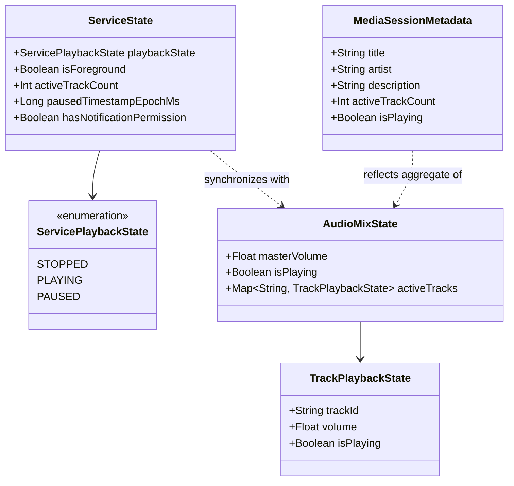
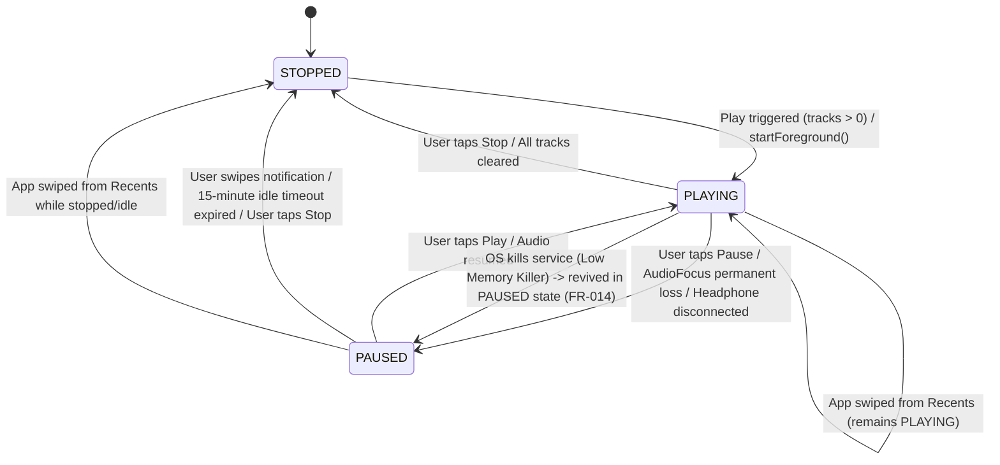

# Data Model: Continuous Background Audio Service & Dependency Injection

**Feature**: `002-foreground-audio-service`  
**Date**: 2026-10-17  
**Status**: Completed  

---

## 1. Domain Entities & State Models



---

## 2. Entity Specifications

### 2.1 `ServicePlaybackState` (Enum)
Represents the discrete operational lifecycle of the background playback service.

| Value | Description |
|---|---|
| `STOPPED` | No audio is playing, foreground service is demoted or stopped, resources released. |
| `PLAYING` | One or more audio streams are actively playing; service is in the foreground with active notification and wakelock. |
| `PAUSED` | All audio streams are paused; notification is dismissible; 15-minute idle auto-shutdown timer is ticking. |

---

### 2.2 `ServiceState` (Data Class)
State snapshot exposed by `NekoyumePlaybackService` via reactive `StateFlow`.

```kotlin
data class ServiceState(
    val playbackState: ServicePlaybackState = ServicePlaybackState.STOPPED,
    val isForeground: Boolean = false,
    val activeTrackCount: Int = 0,
    val pausedTimestampEpochMs: Long? = null,
    val hasNotificationPermission: Boolean = true
)
```

**Validation & Invariants:**
- `isForeground` MUST be `true` whenever `playbackState == ServicePlaybackState.PLAYING`.
- `activeTrackCount` MUST be `>= 0`.
- When `playbackState == ServicePlaybackState.PAUSED`, `pausedTimestampEpochMs` MUST be a valid non-null epoch millisecond timestamp representing when pause was initiated.
- When `playbackState != ServicePlaybackState.PAUSED`, `pausedTimestampEpochMs` MUST be `null`.

---

### 2.3 `MediaSessionMetadata`
Consolidated metadata rendered in Android system notification, lock screen, and Bluetooth AVRCP displays.

```kotlin
data class MediaSessionMetadata(
    val title: String,            // e.g. "Nekoyume Soundscape"
    val artist: String,           // e.g. "Ambient White Noise"
    val description: String,      // e.g. "Playing 3 sounds (Rain, River, Wind)"
    val activeTrackCount: Int,
    val isPlaying: Boolean
)
```

**Formatting Rules:**
- If `activeTrackCount == 0`: `title` = "Nekoyume", `description` = "Paused / Ready".
- If `activeTrackCount == 1`: `title` = "Nekoyume Soundscape", `description` = "Playing 1 sound ({TrackName})".
- If `activeTrackCount > 1`: `title` = "Nekoyume Soundscape", `description` = "Playing {count} sounds".

---

## 3. Lifecycle State Transitions



---

## 4. Integration with Core Audio Models

The service layer wraps and coordinates the pure domain models from Feature 001:
- `AudioMixState`: Single source of truth for runtime track volume and playback status (`com.bl4ckswordsman.nekoyume.core.audio.model.AudioMixState`).
- `SoundTrack`: Catalog sound descriptor with unique ID and asset path (`com.bl4ckswordsman.nekoyume.core.audio.model.SoundTrack`).
- `NekoyumeAudioFocusManager`: Manages Android audio focus requests, transient ducking factors, and permanent loss events.
