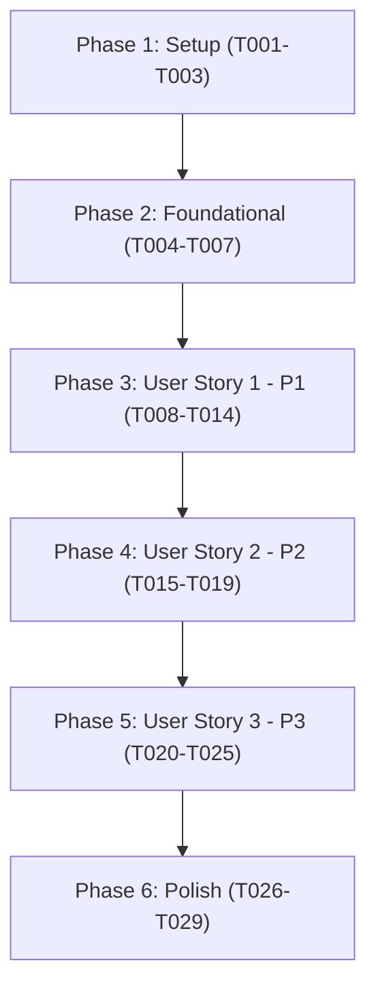

# Tasks: Continuous Background Audio Service & Dependency Injection

**Feature**: `002-foreground-audio-service`  
**Date**: 2026-10-17  
**Input**: Design artifacts from [plan.md](plan.md), [spec.md](spec.md), [data-model.md](data-model.md), [research.md](research.md), and [media-session-contract.md](contracts/media-session-contract.md)  

---

## Phase 1: Setup (Shared Infrastructure)

**Purpose**: Configure build dependencies, plugins, and platform manifest permissions for AndroidX Media3 Session and Google Hilt.

- [X] T001 Add Media3 Session and Hilt dependencies to `gradle/libs.versions.toml`
- [X] T002 [P] Configure Hilt and Media3 plugins and dependencies in `build.gradle.kts` and `app/build.gradle.kts`
- [X] T003 [P] Declare foreground service, wake lock, and notification permissions in `app/src/main/AndroidManifest.xml`

---

## Phase 2: Foundational (Blocking Prerequisites)

**Purpose**: Application-level DI initialization, shared domain models, and core audio dependency injection bindings.

**⚠️ CRITICAL**: Must complete before any user story implementation can begin.

- [X] T004 Annotate NekoyumeApplication with `@HiltAndroidApp` in `app/src/main/java/com/bl4ckswordsman/nekoyume/NekoyumeApplication.kt`
- [X] T005 [P] Create `ServiceState` and `ServicePlaybackState` data models with `isForeground` invariant and paused timestamp rules in `app/src/main/java/com/bl4ckswordsman/nekoyume/core/audio/service/ServiceState.kt`
- [X] T006 [P] Create `AudioModule` with `SingletonComponent` bindings for `SoundCatalogRepository`, `NekoyumeAudioFocusManager`, and `AudioLoopEngine` in `app/src/main/java/com/bl4ckswordsman/nekoyume/di/AudioModule.kt`
- [X] T007 [P] Create unit tests for `AudioModule` DI graph resolution in `app/src/test/java/com/bl4ckswordsman/nekoyume/di/AudioModuleTest.kt`

**Checkpoint**: Core DI foundation and shared models ready. User story implementation can now begin.

---

## Phase 3: User Story 1 - Continuous Background Playback During Screen-Off & Multitasking (Priority: P1) 🎯 MVP

**Goal**: Deliver seamless, uninterrupted background playback for multi-stream soundscapes when the screen is turned off or the app is backgrounded, complying with Android 14+ `mediaPlayback` foreground service requirements.

**Independent Test**: Start playback of an ambient mix, turn off the screen or switch apps, and verify multi-stream audio continues looping without stutter or process death for 30+ minutes (SC-001).

### Tests for User Story 1

> **NOTE: Write these tests FIRST and ensure they FAIL before implementation.**

- [X] T008 [P] [US1] Create unit test for service foreground promotion and lifecycle transitions in `app/src/test/java/com/bl4ckswordsman/nekoyume/core/audio/service/NekoyumePlaybackServiceTest.kt`

### Implementation for User Story 1

- [X] T009 [P] [US1] Implement `MultiStreamPlayerAdapter` bridging `AudioLoopEngine` to Media3 `Player` in `app/src/main/java/com/bl4ckswordsman/nekoyume/core/audio/service/MultiStreamPlayerAdapter.kt`
- [X] T010 [US1] Implement `NekoyumePlaybackService` extending `MediaSessionService` annotated with `@AndroidEntryPoint`, wiring `MultiStreamPlayerAdapter` to `MediaSession` with foreground promotion on play in `app/src/main/java/com/bl4ckswordsman/nekoyume/core/audio/service/NekoyumePlaybackService.kt`
- [X] T011 [US1] Register `NekoyumePlaybackService` with `android:foregroundServiceType="mediaPlayback"` in `app/src/main/AndroidManifest.xml`
- [X] T012 [P] [US1] Define `PlaybackServiceController` interface in `app/src/main/java/com/bl4ckswordsman/nekoyume/core/audio/service/PlaybackServiceController.kt`
- [X] T013 [US1] Implement `PlaybackServiceControllerImpl` mediating between UI clients and the background service in `app/src/main/java/com/bl4ckswordsman/nekoyume/core/audio/service/PlaybackServiceControllerImpl.kt`
- [X] T014 [US1] Provide `@Singleton` `PlaybackServiceController` binding in `app/src/main/java/com/bl4ckswordsman/nekoyume/di/AudioModule.kt`

**Checkpoint**: User Story 1 complete (MVP). Multi-stream playback runs continuously in the background with foreground service execution.

---

## Phase 4: User Story 2 - System Media Notification & Lock Screen Transport Controls (Priority: P2)

**Goal**: Expose system media notification and lock screen transport controls (play, pause, stop) reflecting active soundscape track count and status.

**Independent Test**: Start playback and verify media notification appears; tapping Pause halts audio within 100ms and switches icon to Play; tapping Play resumes audio; tapping notification body opens `MainActivity` (SC-002).

### Tests for User Story 2

> **NOTE: Write these tests FIRST and ensure they FAIL before implementation.**

- [X] T015 [P] [US2] Create unit test for `MultiStreamPlayerAdapter` transport commands (play, pause, stop) and `MediaSessionMetadata` updates in `app/src/test/java/com/bl4ckswordsman/nekoyume/core/audio/service/MultiStreamPlayerAdapterTest.kt`
- [X] T016 [P] [US2] Create unit test for `PlaybackServiceController` StateFlow synchronization in `app/src/test/java/com/bl4ckswordsman/nekoyume/core/audio/service/PlaybackServiceControllerTest.kt`

### Implementation for User Story 2

- [X] T017 [US2] Implement active soundscape metadata formatting ("Playing X sounds") and media notification configuration in `app/src/main/java/com/bl4ckswordsman/nekoyume/core/audio/service/NekoyumePlaybackService.kt`
- [X] T018 [US2] Configure notification click intent targeting `MainActivity` with `FLAG_ACTIVITY_SINGLE_TOP` in `app/src/main/java/com/bl4ckswordsman/nekoyume/core/audio/service/NekoyumePlaybackService.kt`
- [X] T019 [US2] Annotate `MainActivity` with `@AndroidEntryPoint`, connect play/pause FAB to `PlaybackServiceController`, and handle Android 13+ `POST_NOTIFICATIONS` runtime permission requests in `app/src/main/java/com/bl4ckswordsman/nekoyume/MainActivity.kt`

**Checkpoint**: User Stories 1 and 2 complete. Lock screen and notification transport controls fully functional and synchronized with the UI.

---

## Phase 5: User Story 3 - Graceful Session Lifecycle, Service Tear-Down & Battery Preservation (Priority: P3)

**Goal**: Implement clean service resource release on stop, 15-minute idle timeout on pause, continuous playback during recent app swiping, and paused mix restoration on low-memory process revival.

**Independent Test**: Pause playback and verify service auto-terminates after 15 minutes; swipe app away from recents while playing and verify audio continues; stop playback and verify 100% of wake locks and service instances release within 1s (SC-004).

### Tests for User Story 3

> **NOTE: Write these tests FIRST and ensure they FAIL before implementation.**

- [X] T020 [P] [US3] Create unit test for 15-minute paused idle timeout auto-shutdown in `app/src/test/java/com/bl4ckswordsman/nekoyume/core/audio/service/ServiceIdleTimeoutTest.kt`
- [X] T021 [P] [US3] Create unit test for `onTaskRemoved` retention and process revival state restoration in `app/src/test/java/com/bl4ckswordsman/nekoyume/core/audio/service/ServiceLifecycleRecoveryTest.kt`

### Implementation for User Story 3

- [X] T022 [US3] Implement 15-minute cancellable coroutine idle timeout upon entering paused state in `app/src/main/java/com/bl4ckswordsman/nekoyume/core/audio/service/NekoyumePlaybackService.kt`
- [X] T023 [US3] Implement `onTaskRemoved` in `NekoyumePlaybackService.kt` to sustain playing audio and dismiss stopped service (FR-013)
- [X] T024 [US3] Implement mix state serialization and paused restoration on process revival in `app/src/main/java/com/bl4ckswordsman/nekoyume/core/audio/service/NekoyumePlaybackService.kt` (FR-014)
- [X] T025 [US3] Integrate `NekoyumeAudioFocusManager` transient ducking (attenuate to 0.2f volume) and permanent pause handling in `app/src/main/java/com/bl4ckswordsman/nekoyume/core/audio/service/NekoyumePlaybackService.kt` (FR-015)

**Checkpoint**: All user stories complete. Service lifecycle, battery preservation, and audio focus handling fully functional.

---

## Phase 6: Polish & Cross-Cutting Concerns

**Purpose**: ProGuard rules, static analysis, verification gates, and quickstart end-to-end scenario validation.

- [X] T026 [P] Add ProGuard keep rules for Hilt and MediaSessionService in `app/proguard-rules.pro`
- [X] T027 Run code quality check with `./gradlew lintDebug`
- [X] T028 Run full unit test suite with `./gradlew testDebugUnitTest`
- [X] T029 Execute end-to-end scenarios per `specs/002-foreground-audio-service/quickstart.md`

---

## Dependencies & Execution Order

### Phase Dependencies



- **Setup (Phase 1)**: Can start immediately.
- **Foundational (Phase 2)**: Depends on Phase 1 completion; blocks all user stories.
- **User Story 1 (Phase 3 - MVP)**: Depends on Phase 2 completion.
- **User Story 2 (Phase 4)**: Depends on User Story 1 completion (builds on `NekoyumePlaybackService` and `MultiStreamPlayerAdapter`).
- **User Story 3 (Phase 5)**: Depends on User Story 2 completion (adds idle timeout, focus ducking, and task removal to the established service).
- **Polish (Phase 6)**: Depends on all user stories being complete.

---

## Parallel Execution Examples

### Setup & Foundational Parallel Streams

```bash
# Stream A (Build Configuration):
Task T002: "Configure Hilt and Media3 plugins and dependencies in build.gradle.kts and app/build.gradle.kts"

# Stream B (Manifest Configuration):
Task T003: "Declare foreground service, wake lock, and notification permissions in app/src/main/AndroidManifest.xml"

# Stream C (Data Models & Tests):
Task T005: "Create ServiceState and ServicePlaybackState data models in app/src/main/java/com/bl4ckswordsman/nekoyume/core/audio/service/ServiceState.kt"
Task T007: "Create unit tests for AudioModule DI graph resolution in app/src/test/java/com/bl4ckswordsman/nekoyume/di/AudioModuleTest.kt"
```

### User Story 1 Parallel Streams

```bash
# Stream A (Test):
Task T008: "Create unit test for service foreground promotion in app/src/test/java/com/bl4ckswordsman/nekoyume/core/audio/service/NekoyumePlaybackServiceTest.kt"

# Stream B (Player Adapter):
Task T009: "Implement MultiStreamPlayerAdapter in app/src/main/java/com/bl4ckswordsman/nekoyume/core/audio/service/MultiStreamPlayerAdapter.kt"

# Stream C (Controller Interface):
Task T012: "Define PlaybackServiceController interface in app/src/main/java/com/bl4ckswordsman/nekoyume/core/audio/service/PlaybackServiceController.kt"
```

---

## Phase 7: Convergence

**Source**: `/speckit-converge` run on 2026-10-20 against spec clarifications from Session 2026-10-20.

- [X] T030 Replace `PlaybackServiceControllerImpl` service bridge with a `MediaController`/`SessionToken` API connection — build `MediaController` via `MediaController.Builder(context, sessionToken).buildAsync()`, provide it through the Hilt DI graph, and remove the `startForegroundService` direct-call pattern per FR-012 (contradicts)
- [X] T031 Remove the `remove(KEY_SAVED_MIX)` SharedPreferences branch in `NekoyumePlaybackService.observePlaybackLifecycle()` — mix state must never be erased on explicit stop or when active tracks become empty; only overwrite on active-tracks change per FR-008 and Q4 clarification (contradicts)
- [X] T032 Migrate mix state persistence from `SharedPreferences` to `DataStore<Preferences>` — add `androidx.datastore:datastore-preferences` to `libs.versions.toml` and `app/build.gradle.kts`, update `NekoyumePlaybackService` and `ServiceStateRestorer` to read/write via `DataStore` coroutine API per FR-014 (contradicts)
- [X] T033 Implement cold-launch mix restore in `PlaybackServiceControllerImpl` (or a dedicated `MixStateRepository`) — on `init`, read the persisted `DataStore` mix state and emit it as inactive (stopped) `AudioMixState` to the UI `StateFlow` without starting the service or auto-playing audio per FR-017 (missing)
- [X] T034 Update `MultiStreamPlayerAdapter.getMediaMetadata()` to format the notification subtitle as active sound names joined by ` · ` (e.g., `"Rain · Forest · Fire"`) using `setDisplayTitle()`, and set secondary text to `"N sounds playing"` using `setArtist()`; read sound names from `AudioMixState.activeTracks` keys per FR-005 (partial)
- [X] T035 Add `@Provides @Singleton fun provideAudioFocusManager(@ApplicationContext context: Context): NekoyumeAudioFocusManager` binding to `AudioModule.kt` per FR-009 and plan decision (missing)

---

## Implementation Strategy

### MVP First (User Story 1 Only)
1. Complete **Phase 1: Setup** (dependencies and permissions).
2. Complete **Phase 2: Foundational** (Hilt setup and `ServiceState` models).
3. Complete **Phase 3: User Story 1** (`NekoyumePlaybackService` with `mediaPlayback` foreground promotion).
4. **STOP and VALIDATE**: Verify continuous background playback during screen off using `./gradlew testDebugUnitTest`.

### Incremental Delivery
- **Increment 1 (MVP)**: Continuous background playback during screen-off and multitasking.
- **Increment 2**: Rich media notification, lock screen transport controls, and UI binding.
- **Increment 3**: Resource lifecycle hygiene, 15-minute idle timeout, task removal persistence, and audio focus ducking.
- **Increment 4**: ProGuard optimization, lint validation, and full regression verification.
